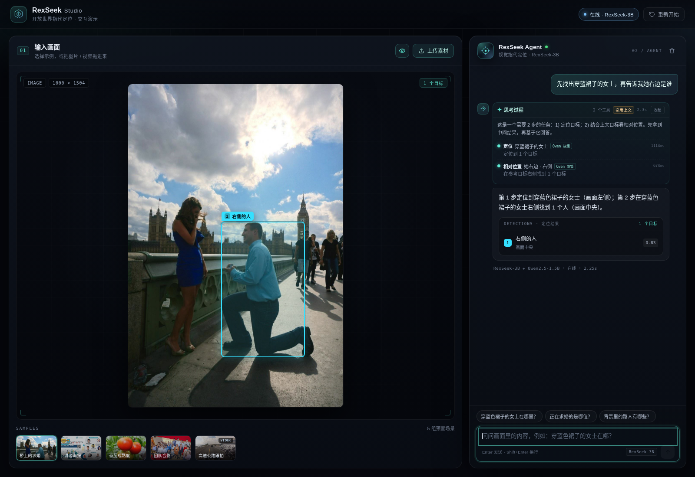
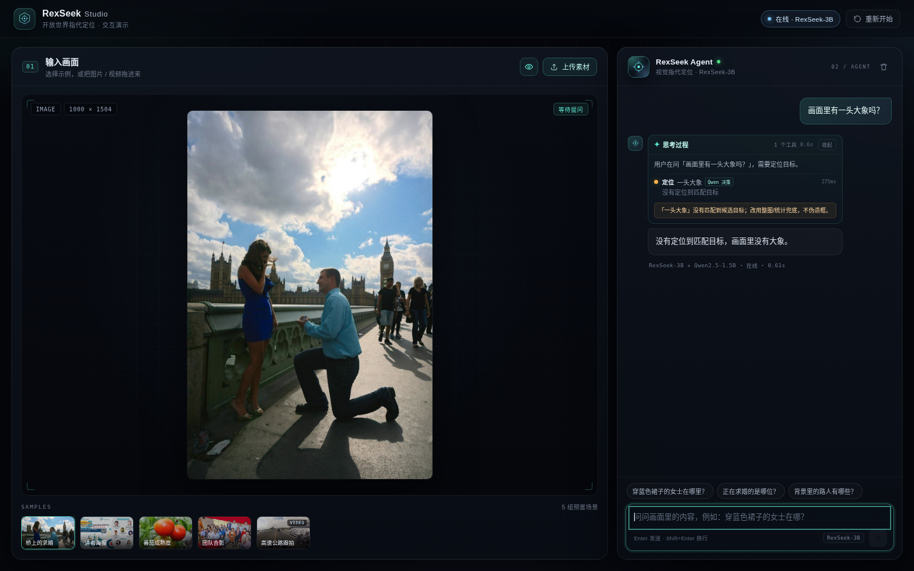
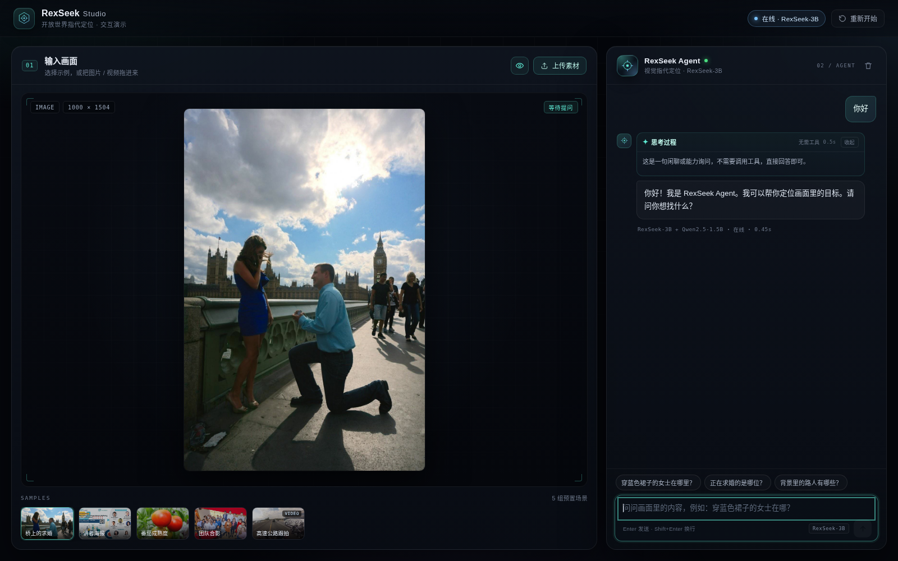

# RexSeek Studio

一个面向 **RexSeek-3B** 的可交互演示页：**左侧是图片 / 视频，右侧是 Agent 对话框**。用自然语言指代画面里的目标，右侧给出回答与位置，画面里同步画出带编号的定位框。闲聊、描述画面、没找到目标时也会正常对话，不会只丢一句「没有结果」。右侧会展示一条可展开的 **Thought → Plan → Tool → Observation → Final** 执行轨迹。

当前版本在本机 RTX 3090 上跑三层模型：**Qwen2.5-1.5B-Instruct 负责对话与组织回答，GroundingDINO-tiny 出候选框，RexSeek-3B 负责指代定位**。单步查询约 **0.4–1.3 秒**，多步任务约 **2–3 秒**；首次加载约 15–20 秒，显存占用约 12.5 GB。



---

## 快速开始

### 真实推理（本机 3090）

```bash
cd rexseek-studio
./start_live.sh
```

打开 <http://127.0.0.1:8848>。

脚本会做三件事：

1. 用 `rexseek` conda 环境启动 `rexseek_service.py`（端口 9000，加载 GDINO + RexSeek-3B + Qwen2.5-1.5B）；
2. 等模型就绪；
3. 启动 UI 服务（端口 8848），并以 `--engine proxy` 指向 9000。

自定义端口：

```bash
REXSEEK_PORT=9002 UI_PORT=8850 ./start_live.sh
```

### 演示模式（没有 GPU 也能看）

```bash
python3 server.py
```

内置 5 组样例的框和回答是预先写好的（`data/samples.json`），用于快速预览 UI；
页面右上角会显示「演示模式 · 内置样例」，回答的 meta 也标为「演示」。没有 GPU 的机器用它看交互是够的。

---

## Agentic 能力

服务端每个请求都会返回一条可展开的执行轨迹（`trace`），而不是只给最终答案：

| 能力 | 实现方式 |
|---|---|
| 任务理解与规划 | 按“先 / 再 / 然后 / 最后”以及“逗号 + 她/右边/第二”拆分子任务；最多 3 步，trace 展示每步计划 |
| 工具调用与调度 | 工具 `ground / count / describe / relative / resolve / clarify`；Qwen 输出结构化 JSON tool call，规则做 schema/一致性校验 |
| 状态记忆 | `session_id` 保存最近主体、目标、结果集；只有 `ground` 更新主语，缺少主语时主动 `clarify` |
| 异常恢复 | 工具异常记录并重试；`ground` 空结果降级到统计/描述；相对位置失败回退全图；trace 里显示 amber 的 recovery 行 |


> 这是**受约束的 agent loop**：1.5B 的规划能力有限，所以工具选择用“Qwen 分类 + 规则校验”双保险，
> 而不是让 1.5B 自由生成 ReAct 文本。trace 里的 `Qwen 决策` / `规则校验` 会标出每步实际来源。

### P0 正确性修正（已落地）

- **复合句拆分**：`找出蓝裙女士，她右边是谁` 现在拆成 `ground → relative` 两步，不会再整句塞给 relative；
- **“最后”/逗号指代**：`先数…再找…最后看她` 能拆成 3 步；
- **结构化工具调用**：Qwen 输出 `{"tool":...,"args":{...}}`，服务端校验工具名/参数类型/取值；
- **规则保护**：计数、描述、指代、相对位置这类明确请求不会被 JSON 误分类覆盖；
- **记忆修复**：`count` / `relative` 不再更新 `last_subject`；没有明确主语时“她是谁”会追问，而不是拿 `last_objects[-1]` 硬答；
- **序数/方位**：`把左边第二个人框出来` 会走 `relative(direction=left, ordinal=2)`。

### 演示 Agentic 的三组问题

```text
你好
  -> 0 个工具，直接回答（route=chat）

先找出穿蓝裙子的女士，再告诉我她右边是谁
  -> 2 步计划：ground -> relative；返回 1 个框 + 两步 trace

她右边是谁？
  -> 同一 session 内引用上文主体，不再重复定位蓝裙女士

画面里有一头大象吗？
  -> ground 空结果 -> recovery 行 -> 0 个框，自然回答“没有大象”
```



---

## P1 已落地：Session 持久化

服务端新增 `session_store.py`（SQLite），把 Agent 状态落盘：

```text
data/sessions.db
├── id         session_id
├── data       JSON：last_subject / last_objects / last_query / history / image_key
└── updated    TTL 7 天
```

- `session_id` 格式校验：`s_` + 6–64 位字母/数字/下划线/短横线；
- 前端用 `crypto.randomUUID()` 生成，存 `localStorage`，刷新页面会恢复；
- 换图时如果 `image_key` 变化，服务端会清空 `last_subject/last_objects`，避免拿旧图目标回答新图；
- 服务重启后，Agent 从 SQLite 重新加载 session，多轮记忆继续可用；
- 前端右上角显示「已恢复 N 轮 / 新会话 / 会话已保存」，鼠标悬停可看完整 ID。

接口：

```text
POST /api/session        {} 或 {"session_id": "s_..."}  → {session_id, resumed, turns}
GET  /api/session/{id}   → {session_id, exists, turns, updated, image_key, history}
```

实测：

```text
第一次：找出穿蓝色裙子的女士 → 1 个框
重启 rexseek_service.py
同一 session 再问：她是谁
→ 你指的是穿蓝色裙子的女士，它在画面左侧（1 个框）
GET /api/session/{id} → turns=2
```

> 注意：当前只恢复 **Agent 记忆和会话元数据**，不会把历史聊天气泡重新画到界面上；刷新后聊天窗口是新的，但「她/他/刚才」仍能正确指代。

---

## P0 已落地：视觉索引缓存 + SSE 流式

### 1. 同图不再重复跑视觉塔

服务端新增内容哈希缓存：

```text
POST /api/index
{
  "media": {"sample_id": "proposal", "kind": "image",
            "width": 1000, "height": 1504,
            "data_url": "data:image/jpeg;base64,..."}
}
→ {"image_id": "b981...", "cached": false, "index_ms": 736, "candidates": 7}
```

- 图片选中 / 上传后，前端立刻调 `/api/index` 预热，不阻塞输入；
- 缓存 key = `sha256(image_bytes)`；
- 缓存内容：解码图、GDINO 候选框、CLIP/ConvNeXt 视觉特征、projected visual tokens；
- 同一张图再次提问时，跳过预处理 / YOLOE / CLIP / ConvNeXt，只跑 Qwen + 后处理；
- LRU：解码图 16 张、视觉特征 8 张、候选框 32 组。

实测（本机 3090，非板卡）：

| 场景 | 时延 |
|---|---:|
| `/api/index` 首次 | 0.74 s |
| `/api/index` 命中 | 0.05 s |
| 同图首问（已索引） | 0.9–1.2 s |
| 同图 count 查询（候选框命中） | ~0.05 s |
| 未索引冷启动 | ~1.2 s |

> 板卡链路可以把这里替换成：缓存 640/336/768 预处理 tensor + YOLOE proposals + CLIP/ConvNeXt 特征；
> 同图首问只需 Qwen prefill/decode，目标约 70 ms。

### 2. 两级缓存：prepare 图像 tensor + 同问题答案

- **prepare 图像侧缓存**：`pixel_values(336)` / `pixel_values_aux(768)` 以及 pad/resize 元数据按 image hash 缓存；
  boxes 和 question 每次仍然重新构造。日志里 ground 工具从 ~668 ms 降到 ~616 ms。
- **同图同问题答案缓存**：key = `(image_hash, normalized_query)`；命中直接返回框 + 回答，约 **4 ms**。
  含“她/他/它/刚才/第二个/再/左边/右边”等指代或相对位置的问题不缓存，继续走 session memory。

实测：

```text
首次 ground 0.9–1.2 s
同问题第二次 0.004 s（cached=True）
count 首次 0.05 s
count 第二次 0.004 s
index 首次 0.76 s
index 命中 0.005 s
```

### 3. SSE 流式 + 先出框

新增：

```text
POST /api/chat/stream
Content-Type: text/event-stream
```

事件顺序：

```text
ack        收到，先看一下画面
thought    思考
plan       计划（工具列表 / Qwen 决策）
tool_start 工具开始
tool       工具结束（observation / duration）
boxes      先返回框，前端立即绘制
token      Qwen 逐 token 流式文本
final      完整结果（reply / objects / trace / meta）
```

前端已经去掉固定 `minThink`：图片索引在后台跑，提问后立即显示回执；工具完成后**框先出现**，Qwen 文本随后逐字追加。失败时回退到 `/api/chat`。

---

## 现在哪些是「真的」

| 内容 | 来源 |
|---|---|
| 图片 / 视频素材 | RexSeek 仓库自带 demo 图 + 一段公开 mmdetection 测试片段 |
| 图片检测框 | **真实推理**：GDINO-tiny 候选框 → RexSeek-3B 输出 `<objN>` → 映射回原图 |
| 对话与回答文字 | **Qwen2.5-1.5B-Instruct**（本地权重，无下载）根据对话上下文、检测结果和统计生成；模型不可用时回退到模板 |
| 画面描述 | GroundingDINO 统计类别/数量，Qwen 负责组织语言；不是像素级 caption |
| 视频框 | 对**当前帧**做一次真实推理；不是逐帧跟踪 |
| 执行轨迹 trace | 服务端真实返回：规划、工具、观察、耗时、恢复事件；前端只负责渲染 |



页面右上角的「在线 · RexSeek-3B」和每条回答下面的「在线」表示走的是真实服务；
「演示」则表示走的是内置 mock。对话模型是本地已有的 `Qwen2.5-1.5B-Instruct`，没有下载任何新模型。

### 实测输出示例

```text
问：你好
答：你好！我是 RexSeek Agent。我可以帮你定位画面里的目标。请问你想找什么？
框：无（route=chat，0.8s）

问：穿蓝色裙子的女士在哪里？
RexSeek raw: <ground>the person wearing a blue dress</ground><objects><obj3></objects>
答：穿蓝色裙子的女士在画面左侧。
框：[0.170, 0.349, 0.373, 0.842]（归一化坐标）
耗时：1.1s

问：画面里有一头大象吗？
答：画面里没有大象。
框：无（route=grounding，0.4s）
```

---

## 界面与交互

- **左侧媒体区**：拖拽 / 上传图片或视频；5 组示例一键切换；检测框带编号与颜色；视频可播放、暂停、拖动进度条；可隐藏标注。
- **右侧 Agent 区**：欢迎引导 + 推荐问题；可展开的「思考过程」（计划、工具、观察、耗时、Qwen/规则来源）；「定位结果」卡片与画面框双向联动；回答可复制；支持连续追问和指代。
- **真实模式下的视频**：发送问题时会暂停视频，对当前帧做一次推理，回答会注明「当前结果基于视频的这一帧」。
- **深链接**：`/?sample=highway&ask=找出那辆白色大巴` 可以直接分享一段演示。

### 预置演示脚本（真实模式建议问法）

| 场景 | 建议提问 | 说明 |
|---|---|---|
| 桥上的求婚 | 先找出穿蓝裙子的女士，再告诉我她右边是谁 → 她右边是谁？→ 她是谁？ | 多步规划、相对位置、指代记忆 |
| 桥上的求婚（基础） | 穿蓝色裙子的女士在哪里？→ 正在求婚的是哪位？→ 画面里有几个人？ | 属性指代、关系、计数 |
| 讲者海报 | 讲者里有哪几位女性？→ 左上角戴眼镜的男士是谁？→ 右上角的女士是谁？ | 区域内人群检索 |
| 番茄成熟度 | 哪些番茄已经熟了？→ 左下角的青番茄在哪？→ 画面里一共有几颗番茄？ | 属性判断、计数 |
| 团队合影 | 穿橙色连衣裙的女士在哪？→ 谁穿着红色上衣？→ 最左边的人是谁？ | 人群中的服饰检索 |
| 高速公路跟拍 | 画面里有哪些车？→ 找出那辆白色大巴 → 右边的摩托车手呢？ | 视频当前帧目标检测 |

---

## 目录结构

```text
rexseek-studio/
├── server.py               # UI 服务：静态资源 + /api/chat（mock/proxy 两种引擎）
├── rexseek_service.py      # 真实服务：GDINO + RexSeek-3B + Qwen2.5 对话（GPU）
├── agent.py                # Agent 规划/工具/记忆/恢复，输出 trace
├── session_store.py        # SQLite session 持久化
├── start.sh                # 启动 UI（默认 mock）
├── start_live.sh           # 启动真实服务 + UI
├── engine/
│   ├── mock_engine.py      # 内置样例 + 关键词路由
│   └── proxy_engine.py     # 转发到 rexseek_service.py
├── data/samples.json       # 素材、mock 问答、真实提示词、live 推荐问题
├── web/                    # 前端（原生 HTML/CSS/JS，无构建）
└── docs/preview.png
```

---

## 真实推理服务

`rexseek_service.py` 的链路：

```text
POST /api/chat (messages + media.data_url)
        │
        ├─ 路由：闲聊 / 描述 / 定位
        ├─ 定位：GroundingDINO-tiny → 候选框（按类别 NMS）
        │         RexSeek-3B      → <ground>...</ground><objects><objN>...</objects>
        │         映射 objN → 原图归一化框
        ├─ 描述：GroundingDINO 统计类别/数量
        ├─ Agent 规划：拆分子任务 → Qwen 工具分类 → 规则校验
        ├─ 工具执行：ground / count / describe / relative / resolve / clarify
        └─ Qwen2.5-1.5B-Instruct → 结合执行轨迹、框和统计生成回答
```

返回里多了 `trace` 字段：

```json
"trace": [
  {"type": "thought", "text": "这是一个需要 2 步的任务……"},
  {"type": "plan", "steps": [{"tool": "ground", "args": {"target": "穿蓝色裙子的女士"}, "chosen_by": "qwen"}]},
  {"type": "tool", "tool": "ground", "status": "ok", "observation": "定位到 1 个目标", "duration_ms": 1114},
  {"type": "recovery", "status": "warn", "text": "没有匹配到候选目标；改用统计兜底，不伪造框。"}
]
```

- 定位模型：`/cix/models_orig/IDEA-Research__RexSeek-3B`（官方权重，ConvNeXt-Large 辅助塔）
- 对话模型：`/cix/rexseek-studio/models/Qwen2.5-1.5B-Instruct`（本地已有，无下载）
- 候选框模型：`models/grounding-dino-tiny`
- 环境：`/home/mingle/miniconda3/envs/rexseek`（torch 2.5.1 + cu124）
- 默认阈值：GDINO box 0.2；不同样例可在 `samples.json` 里用 `box_threshold` 覆盖（如高速视频 0.4）
- 显存：约 12.5 GB；24 GB 的 3090 可以留出足够余量

环境变量：

```bash
REXSEEK_MODEL=/path/to/RexSeek-3B-local
REXSEEK_GDINO=/path/to/grounding-dino-tiny
REXSEEK_CHAT_MODEL=/path/to/Qwen2.5-1.5B-Instruct
REXSEEK_REPO=/path/to/rexseek/repo
REXSEEK_PY=/path/to/rexseek/env/bin/python   # 给 start_live.sh 用
```

服务本身只监听 `127.0.0.1`。如果要给局域网用，启动时加 `--host 0.0.0.0`，并自行加反向代理与鉴权。

---

## 接入自己的推理服务

UI 侧的 `--engine proxy` 只依赖一份简单的 JSON 协议：

```
POST {endpoint}/api/chat
{
  "messages": [{"role": "user", "content": "..."}],
  "media": {
    "sample_id": "proposal",
    "kind": "image",
    "name": "桥上的求婚",
    "width": 1000,
    "height": 1504,
    "data_url": "data:image/jpeg;base64,..."
  },
  "video_time": 0
}
```

返回：

```json
{
  "reply": "「穿蓝色裙子的女士」在画面左侧。",
  "objects": [
    {
      "id": "obj3",
      "label": "穿蓝色裙子的女士",
      "short": "穿蓝色裙子的女士",
      "color": "#35e0ff",
      "box": [0.17, 0.35, 0.37, 0.84],
      "score": 0.82,
      "where": "画面左侧",
      "track": [{"t": 0.0, "box": [0.17, 0.35, 0.37, 0.84]}]
    }
  ],
  "meta": {"engine": "rexseek", "model": "RexSeek-3B + Qwen2.5-1.5B", "route": "grounding", "demo": false}
}
```

- `box` / `track[].box` 为归一化 `[x1, y1, x2, y2]`。
- `track` 可选；前端会按 `video_time` 在关键帧之间线性插值。
- `reply` 支持 `**加粗**`、`` `代码` ``、空行分段和 `- 列表`。

`data_url` 由前端生成：图片最长边 1280；视频取当前帧。因此推理服务不需要和 UI 共享文件。

---

## 定制示例素材

`data/samples.json` 是唯一数据源。关键字段：

```json
{
  "id": "my_scene",
  "kind": "image",
  "title": "场景名",
  "file": "assets/samples/my_scene.jpg",
  "width": 1600,
  "height": 900,
  "gdino_prompt": "person.",
  "box_threshold": 0.2,
  "roi": [0.0, 0.0],
  "suggestions": ["演示模式下的推荐问题"],
  "live_suggestions": ["真实模式下的推荐问题"],
  "objects": [
    {"id": "obj_1", "label": "完整标签", "short": "短标签", "color": "#35e0ff",
     "box": [0.12, 0.2, 0.35, 0.6], "score": 0.95, "where": "画面左侧"}
  ],
  "default_reply": "演示模式兜底回答",
  "intents": [
    {
      "id": "find_obj",
      "keywords": ["关键词"],
      "object_ids": ["obj_1"],
      "en_query": "the person wearing a red hat",
      "zh_label": "戴红帽子的人",
      "reply": "演示模式回答"
    }
  ]
}
```

- 真实模式用 `en_query` + `gdino_prompt` 走模型；mock 模式用 `object_ids` + `reply`。
- `roi: [x, y]` 会过滤掉中心点不在此范围内的候选框（例如海报只保留右侧讲者区）。
- `box_threshold` 可按样例调整候选框召回。
- 新增图片放进 `web/assets/samples/`，刷新即可。

---

## 已知边界

- **1.5B 规划器能力有限**：工具分类偶尔会错，所以有规则校验兜底；复杂开放任务（超过 3 步、需要外部搜索）还不支持。
- **Qwen 只有 1.5B**：闲聊和短回答够用，复杂推理、长描述或严格的事实核对会弱一些；定位框本身仍由 RexSeek 决定。
- **名字 / OCR 类问题偏弱**：RexSeek 主要面向指代定位，不擅长读海报上的小字姓名；真实模式下推荐用「左上角戴眼镜的男士」「右上角的女士」这类外观/位置描述。
- **视频没有逐帧跟踪**：真实模式对当前帧推理一次，框不随播放移动；示例视频里原来那套时间轴关键帧是 mock 模式的效果。
- **候选框决定上限**：GDINO 没框到的目标，RexSeek 也选不出来；复杂小目标可能漏检。
- 这是演示原型，没有登录、限流、持久化；对外网暴露前请加反向代理与鉴权。

---

## 故障排查

```bash
nvidia-smi                                   # 确认 3090 可见
curl http://127.0.0.1:9000/health            # 推理服务
curl http://127.0.0.1:8848/api/health        # UI 服务（应显示 "name": "proxy"）
```

- 若 `nvidia-smi` 在受限 shell 里报 “couldn't communicate with the NVIDIA driver”，先确认 `/dev/nvidia*` 是否存在；某些沙箱会把 `/dev` 换成精简 tmpfs。
- 端口占用：换 `REXSEEK_PORT` / `UI_PORT`。
- 模型加载失败：确认 `HF_HUB_OFFLINE=1`、模型路径和 `rexseek` 环境。

---

## 设计说明

- 深色控制台风格，左侧保留「扫描 / 取景框」的视觉语言，右侧对话保持阅读优先。
- 检测框颜色与结果编号严格对应；目标超过 3 个时标签收成编号，悬停展开。
- 真实模式的回答短、位置明确；不伪造模型没有输出的判断依据。
- 动画可被系统「减少动态效果」设置关闭。

